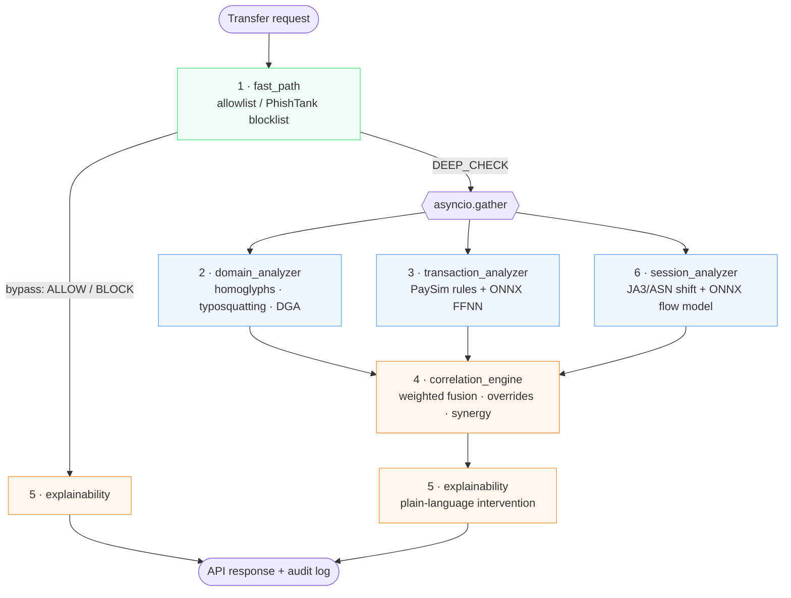

# 🛡️ Teleprzyjaciele: Hybrid Fraud & Phishing Shield

> Real-time, explainable fraud and phishing detection for bank transfers, built to protect **elderly users** and designed for **IBM LinuxONE (s390x)**.

**IBM Z Datathon 2026** · Team **Teleprzyjaciele** · Theme: *Real-Time AI for Critical Decisions*


---

## The problem

Scams aimed at seniors rarely look like hacking. They usually combine several things:

- a **look-alike bank website** (`mbank.pl.weryfikacja-konta.top`, `a1iorbank.pl`, Cyrillic `аllegro.pl`),
- a **panicked transfer** that empties the account to a "safe account",
- sometimes a **hijacked session**, where the attacker reuses a stolen token from a new network.

Each signal on its own can look harmless. This project checks every transfer across **three layers (domain, transaction, session)**, combines the evidence, and returns **a decision plus a plain-language explanation** that a stressed elderly person can follow. Everything runs within a **25 ms** budget per transaction.

## Key features

| | |
|---|---|
| ⚡ **Fast-path triage** | Allowlist (Polish banks, BLIK, PayU, Allegro, InPost, OLX…) and a PhishTank blocklist settle obvious cases immediately, so the models never run for them. |
| 🔤 **Domain intelligence** | Homoglyph/punycode detection (UTS #39 skeletons, mixed scripts, `rn→m`, `1→l`), Levenshtein typosquatting against brand names, DGA detection (Shannon entropy and consonant/vowel ratio), and a boost for suspicious TLDs. |
| 💸 **Transaction analysis** | PaySim domain rules (account drain, mule destination accounts) fused with an **FFNN fraud model exported to ONNX**. |
| 🕵️ **Session analysis** | Detects JA3 TLS-fingerprint and ASN shifts against a bounded LRU baseline, plus an ONNX network-flow anomaly model trained on CIC-IDS. |
| 🧮 **Correlation engine** | Weighted fusion, critical overrides, and cross-layer synergy penalties produce four graded actions: `ALLOW` / `STEP_UP` / `DELAY` / `BLOCK`. |
| 🧓 **Senior-friendly explainability** | Jargon-free warnings, a single prioritised primary reason, and an **anti-panic message on `DELAY`** ("Your money is safe… you have 15 minutes…"). |
| 🧯 **Resilient by design** | Analyzers run in parallel with `asyncio.gather`. A module that fails falls back to a deterministic safe value (`FALLBACK_TRIGGERED`) and the pipeline keeps running. |
| 📜 **Audit trail** | Every decision writes one deterministic `[AUDIT]` line to `pipeline_audit.log`, ready for a SIEM. |

---

## Architecture



### How a decision is made

1. **Fast path** (`src/fast_path`)
   - Trusted domain *and* amount ≤ 1.5 × the user's average → `ALLOW` (`KNOWN_BENIGN`); the pipeline stops here.
   - Trusted domain with an unusual amount → deep check (`UNUSUAL_AMOUNT`).
   - Domain (or a parent domain) is on PhishTank → `BLOCK` (`BLACKLISTED_PHISH`); the pipeline stops here. Domains in the Tranco top 10k are excluded so shared hosts like `sites.google.com` don't get blocked wholesale.
   - Anything else → deep check (`UNKNOWN_DOMAIN`).

2. **Deep analysis.** Three analyzers run in parallel, and each returns a risk score between 0 and 1 together with reason codes.

   | Analyzer | Main signals | Reason codes |
   |---|---|---|
   | `domain_analyzer` | punycode/IDN, mixed scripts, homoglyph skeleton → brand (0.95); Levenshtein d≤1 → 0.90, d=2 → 0.70; DGA → 0.75; suspicious TLD +0.15 | `HOMOGLYPH_DETECTED`, `TYPOSQUATTING_LEVENSHTEIN`, `DGA_HIGH_ENTROPY` |
   | `transaction_analyzer` | only `TRANSFER`/`CASH_OUT` are risky (true for 100% of PaySim fraud); ≥85% of the balance drained → 0.85; destination balance stays 0 → mule; ONNX score | `HIGH_RISK_TX_TYPE`, `ACCOUNT_DRAIN_ZERO_BALANCE`, `MULE_DEST_ANOMALY`, `ONNX_ANOMALY_HIGH`, `LOW_RISK_PAYMENT` |
   | `session_analyzer` | JA3 or ASN changed mid-session → 0.85; ONNX flow anomaly on duration, bytes/s and packet rate | `SESSION_HIJACK_FOOTPRINT_SHIFT`, `FLOW_ANOMALY_HIGH` |

3. **Correlation** (`src/correlation_engine`)
   - **Critical override:** domain ≥ 0.90, transaction ≥ 0.85 or session ≥ 0.85 → `BLOCK` with score 1.0.
   - **Weighted fusion:** `0.30·domain + 0.30·session + 0.40·transaction`.
   - **Synergy penalties:**
     - +0.15 when domain and transaction risk are both ≥ 0.40 (`CROSS_LAYER_SYNERGY_PENALTY`).
     - +0.25 when session risk ≥ 0.70 and transaction risk ≥ 0.40, the adversary-in-the-middle (AiTM) hijack pattern (`SESSION_HIJACK_SYNERGY`).
   - **Action matrix:**

     | Final score | Action | Meaning |
     |---|---|---|
     | < 0.35 | `ALLOW` | Transfer goes through. |
     | 0.35 – 0.55 | `STEP_UP` | Extra authentication. |
     | 0.55 – 0.75 | `DELAY` | Transfer held for 15 minutes with an anti-panic message. |
     | ≥ 0.75 | `BLOCK` | Transfer stopped. |

4. **Explainability** (`src/explainability`)
   - Picks one primary reason by priority: phishing > account drain > mule account > …
   - Fills a senior-friendly template with the domain and an amount formatted in PLN.

---

## Repository layout

```
.
├── architecture/            # Design docs & module contracts (PL)
│   ├── pipeline_integration_contract.md
│   ├── modules/             # Per-module I/O contracts and flowcharts
│   └── docs/datathon_abstract.pdf
├── data/                    # PaySim, CIC-IDS, PhishTank, Tranco top-1M, homoglyph map
├── models/                  # Exported ONNX models
│   ├── fraud_detect.onnx    #   transaction FFNN (7 features → 32 → 16 → 1)
│   └── session_anomaly.onnx #   session-flow FFNN (3 features → 16 → 8 → 1)
├── notebooks/               # Training + tf2onnx export (TensorFlow, CPU-only for s390x)
├── demo/demo_scirpt.py      # End-to-end demo: ALLOW, BLOCK and AiTM-hijack scenarios
├── src/
│   ├── api.py               # FastAPI service (POST /check)
│   ├── __init__.py          # create_pipeline() factory + logging bootstrap
│   ├── pipeline.py          # FraudDetectionPipeline orchestrator
│   ├── contracts.py         # TypedDict contracts between modules
│   ├── collaborators.py     # FallbackPolicy, LatencyTracker, AuditService
│   ├── logging_config.py    # Operational + audit loggers
│   ├── fast_path/           # Module 1
│   ├── domain_analyzer/     # Module 2
│   ├── transaction_analyzer/# Module 3
│   ├── correlation_engine/  # Module 4
│   ├── explainability/      # Module 5
│   └── session_analyzer/    # Module 6
├── tests/                   # unittest suites + check_domain.py CLI
└── .github/workflows/       # CD: deploy src/ to the LinuxONE host over SSH
```

---

## Getting started

### Prerequisites

- Python **3.11+**
- On LinuxONE/s390x, install an `onnxruntime` build that supports the platform.

### Install

```bash
python -m venv .venv
source .venv/bin/activate
pip install -r requirements.txt
```

`tensorflow` and `tf2onnx` are needed only to retrain the models in `notebooks/`. Running the pipeline at inference time needs just `numpy`, `onnxruntime`, `fastapi` and `uvicorn`.

### Run the demo

```bash
python demo/demo_scirpt.py
```

The demo builds the pipeline and runs three scenarios:

| Scenario | Input | What it demonstrates |
|---|---|---|
| ✅ Safe | `mbank.pl`, 100 PLN (average 350) | Fast-path `ALLOW` |
| ⛔ Phishing | `http://allegro.pl.showitems.ca/oferta` | PhishTank `BLOCK` |
| 🕵️ AiTM hijack | `mbank.pl`, 6 000 PLN, shifted JA3/ASN, bot-like flow | Deep check across all layers |

### Run the API

```bash
cd src
python api.py          # serves on http://0.0.0.0:8080
```

```bash
curl -s -X POST http://localhost:8080/check \
  -H 'Content-Type: application/json' \
  -d '{
    "domain": "mbank.pl.weryfikacja-konta.top",
    "transaction": {
      "type": "TRANSFER",
      "amount": 14500.0,
      "oldbalanceOrg": 15000.0,
      "newbalanceOrig": 500.0,
      "oldbalanceDest": 0.0,
      "newbalanceDest": 0.0
    },
    "session_context": {
      "session_id": "sess_001",
      "ja3_hash": "771,4865-4866-4867,0-11-10",
      "ip_address": "192.168.1.50",
      "asn": 12345,
      "flow_duration": 15.0,
      "flow_bytes_per_sec": 150.0,
      "packet_rate": 5.0
    }
  }' | python -m json.tool
```

Example response (shape):

```json
{
  "transaction_id": "",
  "action": "BLOCK",
  "final_score": 1.0,
  "override_triggered": true,
  "aggregated_reasons": [
    "TYPOSQUATTING_LEVENSHTEIN",
    "HIGH_RISK_TX_TYPE",
    "ACCOUNT_DRAIN_ZERO_BALANCE",
    "MULE_DEST_ANOMALY",
    "FALLBACK_SESSION",
    "CRITICAL_OVERRIDE_TRIGGERED"
  ],
  "user_intervention": {
    "ui_severity": "WARNING",
    "user_title": "Suspicious Website Address",
    "user_message": "There is a slight typo in the bank's website address (mbank.pl.weryfikacja-konta.top). This could be a fake site created by scammers.",
    "recommended_action": "Do not enter passwords or SMS codes. Carefully check the address in your browser."
  },
  "audit_trail": "[AUDIT] ID= SCORE=1.00 ACTION=BLOCK REASONS=..."
}
```

Interactive OpenAPI docs are served at `http://localhost:8080/docs`.

### Use it as a library

```python
import asyncio
from src import create_pipeline

pipeline = create_pipeline()            # every module can be injected/replaced
result = asyncio.run(pipeline.process_transaction(payload))
print(result["action"], result["user_intervention"]["user_message"])
```

The full payload contract (`transaction_id`, `domain`, `transaction`, `user_context.history_avg_amount`, `session_context`) is defined in [`src/contracts.py`](src/contracts.py) and [`architecture/pipeline_integration_contract.md`](architecture/pipeline_integration_contract.md).

### Check domains from the CLI

```bash
python tests/check_domain.py mbank.pl mbnak.pl a1iorbank.pl qxzvbkt7r.xyz --details
```

---

## Testing

```bash
python -m pytest tests          # or: python -m unittest discover tests
```

The suites cover each module's contract and edge cases:

- **Fast path:** URL normalization, threshold boundaries, the shared-host exclusion.
- **Domain analyzer:** Cyrillic and digit look-alikes, short-brand false positives, DGA, the suspicious-TLD boost.
- **Transaction analyzer:** drain, mule and ONNX fallback cases.
- **Session analyzer:** the real ONNX model plus stubbed sessions.
- **Explainability:** priority resolution, anti-panic de-escalation, the audit format.

Set `PIPELINE_ENV=dev` or `PIPELINE_ENV=test` to switch the orchestrator to **strict mode**. Unexpected analyzer bugs are then raised instead of being masked by fallbacks. Production defaults to fail-open.

---

## Models

Both models are small feed-forward networks trained in TensorFlow and exported with `tf2onnx` (opset 13). Training runs CPU-only so the same artifacts run on s390x.

| Model | Dataset | Features | Architecture |
|---|---|---|---|
| `fraud_detect.onnx` | PaySim (downsized) | type, log(amount), origin/destination balances, drain ratio | Dense 32 → Dropout 0.2 → 16 → sigmoid |
| `session_anomaly.onnx` | CIC-IDS (downsized) | flow duration, log(bytes/s), packet rate | Dense 16 → Dropout 0.2 → 8 → sigmoid |

If a model fails to load or to run inference, its analyzer returns a neutral 0.50 with `FALLBACK_TRIGGERED`. The deterministic rules, such as account drain and footprint shift, still apply.

## Data sources

| File | Purpose |
|---|---|
| `paysim_downsized.csv` | Synthetic mobile-money transactions (transaction model) |
| `cic_ids_downsized.csv` | Network-flow telemetry, benign vs. attack (session model) |
| `phishtank.csv` | Verified phishing URLs (fast-path blocklist) |
| `tranco_top.csv` | Tranco top-1M domains (false-positive suppression) |
| `homoglyphs.csv` | Latin ↔ Cyrillic/Greek confusables (homoglyph skeletons) |

## Deployment

Every push to `main` triggers [`.github/workflows/main.yml`](.github/workflows/main.yml). It copies `src/` to the LinuxONE host over SSH and restarts the `httpapi` systemd service. It needs the repository secrets `HOST`, `USERNAME` and `PASSWORD` (the SSH private key).

## Roadmap / known gaps

- `create_pipeline()` does not wire up `SessionAnalyzer` yet. To get real session scoring instead of the `FALLBACK_SESSION` default, pass `session_analyzer=SessionAnalyzer()` to `FraudDetectionPipeline`.
- The `/check` API does not take `transaction_id` or `user_context` yet, so fast-path amount checks see a history average of 0.
- Possible next steps: a full Public Suffix List instead of the simplified suffix set; per-user baselines kept outside process memory; IBM Z Deep Learning Compiler / Telum on-chip AI acceleration for ONNX.

## Team

**Teleprzyjaciele**, IBM Z Datathon 2026.
