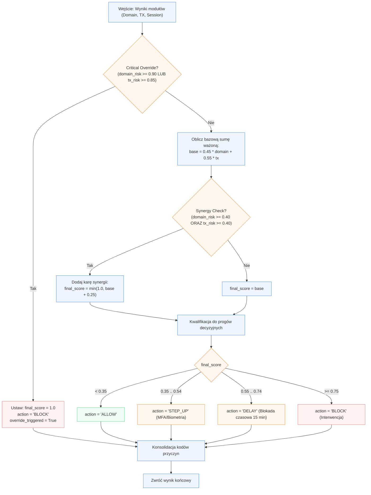

Agregacja wieloźródłowa i silnik decyzji

## 1. Kontrakt I/O

*   **Wejście:**
    ```python
    payload = {
        "domain_risk": float,          # Wynik z Modułu 2 (0.0 - 1.0)
        "domain_reasons": list[str],   # np. ["HOMOGLYPH_DETECTED", "TYPOSQUATTING_LEVENSHTEIN"]
        "tx_risk": float,              # Wynik z Modułu 3 (0.0 - 1.0)
        "tx_reasons": list[str],       # np. ["ACCOUNT_DRAIN_ZERO_BALANCE"]
        "session_risk": float | None   # Opcjonalnie (0.0 - 1.0), domyślnie 0.0 dla MVP
    }
    ```

*   **Wyjście:**
    ```python
    result = {
        "final_score": float,          # Zagregowany wskaźnik ryzyka (0.0 - 1.0)
        "action": str,                 # "ALLOW" | "STEP_UP" | "DELAY" | "BLOCK"
        "override_triggered": bool,    # True jeśli zadziałała twarda reguła bezpieczeństwa
        "aggregated_reasons": list[str]# Skonsolidowana lista kodów dla modułu Explainability
    }
    ```

---

## 2. Przepływ logiczny (Mermaid)



---

## 3. Algorytm i logistyka danych

1.  **Reguła bezwzględnego nadpisania (*Critical Override*):**
    *   Jeśli którykolwiek z sygnałów bazowych osiągnie poziom krytyczny:
	$$\text{domain\_risk} \ge 0.90 \quad \lor \quad \text{tx\_risk} \ge 0.85$$
    *   Średnia ważona jest całkowicie pomijana. System natychmiast przypisuje `final_score = 1.0`, `action = "BLOCK"` oraz flagę `override_triggered = True`. Pojedynczy, ewidentny dowód ataku (np. kradzież domeny lub wyzerowanie konta) uniemożliwia rozmycie wyniku.

2.  **Kalkulacja bazy liniowej (*Weighted Base Score*):**
    *   Gdy żaden sygnał nie wyzwala blokady bezpośredniej, liczona jest suma ważona:
	$S_{\text{base}} = w_d \cdot \text{domain\_risk} + w_t \cdot \text{tx\_risk}$
    *   Wagi referencyjne dla MVP (bez danych sesyjnych):
	$w_d = 0.45, \quad w_t = 0.55$
        *(W przypadku rozbudowy o warstwę sieciową: \\(w_d = 0.35, \, w_t = 0.45, \, w_s = 0.20\\)).*

3.  **Kara za synergię ryzyk (*Synergy Penalty*):**
    *   Ataki socjotechniczne na seniorów celowo operują w strefie średnich wartości pojedynczych wskaźników (np. drobna literówka w URL i nietypowa godzina przelewu).
    *   Warunek korelacyjny:
	$$\text{jeżeli } \text{domain\_risk} \ge 0.40 \ \land \ \text{tx\_risk} \ge 0.40 \implies S_{\text{final}} = \min(1.0, \, S_{\text{base}} + 0.25)$$
    *   W przeciwnym wypadku:
	$S_{\text{final}} = S_{\text{base}}$.

4.  **Taryfikacja akcji (Progi kalibracyjne pod Precision-Recall):**
	*   $S_{\text{final}} < 0.35 \implies \mathbf{ALLOW}$ (Brak utrudnień transakcyjnych).
	*   $0.35 \le S_{\text{final}} < 0.55 \implies \mathbf{STEP\_UP}$ (Wymuszenie drugiego składnika autoryzacji / biometrii).
	*   $0.55 \le S_{\text{final}} < 0.75 \implies \mathbf{DELAY}$ (Kluczowe dla ochrony seniorów: 15-minutowe zamrożenie transakcji przerywające presję czasu wywieraną przez oszusta).
	*   $S_{\text{final}} \ge 0.75 \implies \mathbf{BLOCK}$ (Trwała blokada wypłaty i skierowanie do kontaktu z konsultantem).

---

## 4. Kody przyczyn i flagi decyzyjne

*   `CRITICAL_OVERRIDE_TRIGGERED`: Wykryto bezwzględny indykator ataku wykluczający operację bez względu na inne parametry.
*   `CROSS_LAYER_SYNERGY_PENALTY`: Połączenie umiarkowanie podejrzanej domeny z nietypową transakcją podniosło ocenę ryzyka.
*   `COERCION_DELAY_APPLIED`: Zastosowano bufor czasowy w celu przeciwdziałania socjotechnice i manipulacji.

---
