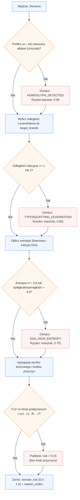

## 1. Kontrakt I/O

*   **Wejście:**
    ```python
    payload = {
        "domain": str,               # np. "mbąnk.pl", "xn--mbnk-81a.pl", "[suspicious link removed]"
        "target_brands": list[str]   # opcjonalnie: lista kluczowych domen referencyjnych (np. [suspicious link removed], [suspicious link removed])
    }
    ```

*   **Wyjście:**
    ```python
    result = {
        "domain_risk": float,        # znormalizowany wynik ryzyka: 0.0 (bezpieczna) do 1.0 (złośliwa)
        "reason_codes": list[str],   # np. ["HOMOGLYPH_DETECTED", "TYPOSQUATTING_LEVENSHTEIN"]
        "details": {
            "is_punycode": bool,
            "has_mixed_scripts": bool,
            "min_levenshtein_dist": int,
            "closest_brand": str | None,
            "shannon_entropy": float     
        }
    }
    ```

---

## 2. Przepływ logiczny (Mermaid)



---

## 3. Algorytm i logistyka danych

1.  **Detekcja Homoglifów i Punycode (Unicode UTS #39):**
    *   Sprawdzenie prefiksu `xn--` (Punycode) w etykietach domeny oraz próba dekodowania `idna`.
    *   Weryfikacja mieszania skryptów (np. znaki cyrylicy `а`, `о`, `р` wplecione w alfabet łaciński.
    *   Zamiana ciągów typu rn $\leftrightarrow$ m oraz cl $\leftrightarrow$ d przed porównaniem.
    *   Szkielet etykiety (`data/homoglyphs.csv`): znaki cyrylicy/greki oraz cyfry udające litery (0→o, 1→l/i, 3→e, 6→b/s) są zamieniane na łacińskie odpowiedniki; trafienie szkieletu w markę (np. `a1iorbank`, `pk0bp`, `1ng`) oznacza homoglif. Znak może mieć kilka celów – sprawdzane są wszystkie warianty (limit 64). SLD z czołówki Tranco (top 100k) pomijamy.
    *   Trafienie skutkuje ustawieniem flagi HOMOGLYPH_DETECTED i przypisaniem ryzyka $\ge 0.95$.

2.  **Detekcja Typosquattingu (Odległość Levenshteina):**
    *   Ekstrakcja nazwy głównej (SLD, np. `pk0-bp` z `suspicious link`).
    *   Obliczenie minimalnej odległości edycyjnej $d_L$ względem referencyjnej listy zaufanych instytucji (target_brands zasilanej z tranco_N26LW-1m.csv): 
	$$d_L(s_1, s_2) = \min(\text{insert}, \text{delete}, \text{substitute})$$
	*   Jeśli $d_L = 1$: TYPOSQUATTING_LEVENSHTEIN (ryzyko 0.90).
	*   Jeśli $d_L = 2$: TYPOSQUATTING_LEVENSHTEIN (ryzyko 0.70).
	*   Jeśli $d_L = 0$: domena oficjalna (ryzyko 0.0 – wyłapywane już w Fast-Path, tu stanowi bezpieczny fallback).
	*   Odległość liczona jest także dla szkieletu kandydata, np. `a11iorbank` → `alliorbank` ($d_L = 1$).
	*   Ten sam SLD co marka z innym sufiksem (`ing.com`) nie jest flagowany – chyba że sufiks jest podejrzanym TLD (`mbank.xyz`, `aliorbank.ru`): wtedy TYPOSQUATTING_LEVENSHTEIN z $d_L = 0$ (ryzyko 0.90).

3.  **Detekcja DGA i Losowości (Entropia Shannona):**
	*   Obliczenie entropii dla etykiety SLD o długości $N$: 
	$$H(S) = -\sum_{i=1}^{k} p(x_i) \log_2 p(x_i)$$
    *   Wskaźnik proporcji spółgłosek do samogłosek oraz występowanie długich ciągów cyfr.
	*   Wartość $H > 3.8$ (dla krótkich ciągów znaków) wskazuje na domenę generowaną maszynowo $\rightarrow$ flaga DGA_HIGH_ENTROPY

4.  **Wyliczenie `domain_risk`:**
    *   Deterministyczna agregacja hierarchiczna:
	$$\text{domain\_risk} = \min\left(1.0, \; \max(\text{risk}_{\text{homoglyph}}, \text{risk}_{\text{typo}}, \text{risk}_{\text{dga}}) + 0.15 \cdot [\text{podejrzane TLD}]\right)$$
    *   Jeśli żaden wskaźnik nie przekroczył progów ostrzegawczych: `domain_risk = 0.05` (szum bazowy dla domen nieznanych).
    *   Podejrzane TLD (masowo nadużywane przez phishing: `xyz, ru, su, tk, ml, ga, cf, gq, top, buzz, icu`) podbijają ryzyko o 0.15 bez osobnego kodu przyczyny, np. `example.xyz` → 0.20, `ailorbank.xyz` → 0.85, `mbank.xyz` → 1.0.


## 4. Kody przyczyn (Reason Codes dla modułu Explainability)

*   `HOMOGLYPH_DETECTED`: Strona używa znaków z obcych alfabetów (np. cyrylicy) lub cyfr udających litery łacińskie (np. `a1iorbank`).
*   `TYPOSQUATTING_LEVENSHTEIN`: Nazwa różni się 1–2 literami od autentycznej domeny bankowej.
*   `DGA_HIGH_ENTROPY`: Losowy ciąg znaków wskazujący na infrastrukturę przestępczą.

