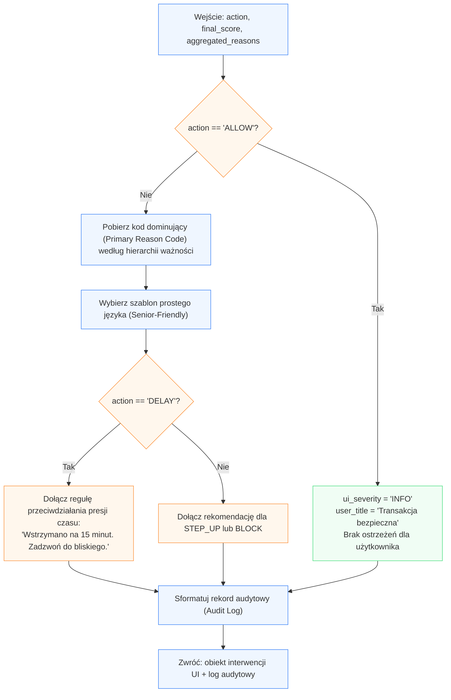

Komunikacja interwencyjna i audytowalność

## 1. Kontrakt I/O

*   **Wejście:**
    ```python
    payload = {
        "final_score": float,            # Zagregowany wskaźnik ryzyka z Modułu 4 (0.0 - 1.0)
        "action": str,                   # "ALLOW" | "STEP_UP" | "DELAY" | "BLOCK"
        "aggregated_reasons": list[str], # Kody przyczyn z poprzednich modułów
        "context": {                     # Opcjonalne metadane transakcji do wstrzyknięcia w szablon
            "domain": str | None,
            "amount": float | None
        }
    }
    ```

*   **Wyjście:**
    ```python
    result = {
        "ui_severity": str,              # "INFO" | "WARNING" | "CRITICAL"
        "user_title": str,               # Zrozumiały nagłówek bez żargonu IT
        "user_message": str,             # Empatyczne wytłumaczenie zagrożenia w prostym języku
        "recommended_action": str,       # Bezpośrednia instrukcja bezpieczeństwa dla seniora
        "audit_summary": str             # Zwięzły rekord audytowy dla analityka bezpieczeństwa
    }
    ```

---

## 2. Przepływ logiczny (Mermaid)



---

## 3. Algorytm i logistyka danych

1.  **Hierarchia wyboru kodu dominującego (*Primary Reason*):**
    *   Jeśli transakcja niesie kilka zagrożeń, interfejs nie może przytłoczyć seniora listą alertów.
    *   Algorytm wybiera **jeden kluczowy powód** według twardej wagi priorytetów:
        1. `HOMOGLYPH_DETECTED` / `TYPOSQUATTING_LEVENSHTEIN` (Oszustwo tożsamościowe / fałszywa strona).
        2. `ACCOUNT_DRAIN_ZERO_BALANCE` (Próba wyczyszczenia oszczędności).
        3. `MULE_DEST_ANOMALY` (Rachunek pośrednika / słupa).
        4. `CROSS_LAYER_SYNERGY_PENALTY` (Połączenie podejrzanej strony i nietypowej kwoty).
        5. `DGA_HIGH_ENTROPY` / `ONNX_ANOMALY_HIGH` (Inne anomalie systemowe).

2.  **Przekład technologii na prosty język (*Plain Language Transformation*):**
    *   Eliminacja żargonu: zakaz używania słów typu *„entropia”*, *„homoglif”*, *„model ONNX”*, *„Punycode”*.
    *   Zamiast: *„Wykryto atak typu homoglyph UTS-39 w domenie xn--mbnk-81a.pl”* \\(\rightarrow\\) Komunikat: *„Strona internetowa udaje Twój bank, używając podmienionych liter. To nie jest prawdziwy bank.”*

3.  **Protokół przeciwdziałania presji czasu (*De-escalation Protocol*):**
    *   Oszuści wymuszają natychmiastowe działanie („policjant”, „awaria konta”).
    *   W przypadku akcji `DELAY` komunikat kładzie nacisk na uspokojenie emocji:
        *   **Akcja:** *„Pieniądze są bezpieczne w banku. Masz 15 minut na spokojne zastanowienie się i kontakt z kimś zaufanym.”*

4.  **Generowanie śladu audytowego (*Audit Trail* na z/OS / LinuxONE):**
    *   Równoległe generowanie zwięzłego wpisu telemetrycznego:
        `[AUDIT] SCORE={final_score:.2f} | ACTION={action} | REASONS={aggregated_reasons} | TS={timestamp}`

---

## 4. Słownik mapowania kodów na komunikaty interwencyjne

| Kod techniczny | Etykieta UI | Komunikat dla seniora (`user_message`) | Rekomendowane działanie (`recommended_action`) |
| :--- | :--- | :--- | :--- |
| **`HOMOGLYPH_DETECTED`** | Fałszywa strona | *„Adres strony wygląda jak nazwa Twojego banku, ale zawiera ukryte znaki z innego alfabetu.”* | *„Zamknij tę stronę. Wejdź do banku wpisując adres ręcznie lub przez oficjalną aplikację.”* |
| **`TYPOSQUATTING_LEVENSHTEIN`** | Podejrzany adres WWW | *„W nazwie strony banku jest drobna literówka. Może to być fałszywa strona stworzona przez oszustów.”* | *„Nie wpisuj haseł ani kodów SMS. Sprawdź dokładnie adres w przeglądarce.”* |
| **`ACCOUNT_DRAIN_ZERO_BALANCE`** | Opróżnienie konta | *„Ten przelew wypłaca prawie wszystkie Twoje pieniądze naraz. To typowy sposób działania oszustów.”* | *„Jeśli ktoś każe Ci przelać oszczędności na 'bezpieczne konto' – rozłącz się, to próba oszustwa.”* |
| **`CROSS_LAYER_SYNERGY_PENALTY`** | Nietypowa operacja | *„Połączenie nieznanego adresu strony z tą kwotą przelewu wykracza poza Twoje codzienne nawyki.”* | *„Wstrzymaj się z realizacją. Skonsultuj ten przelew z członkiem rodziny lub zadzwoń na infolinię banku.”* |

