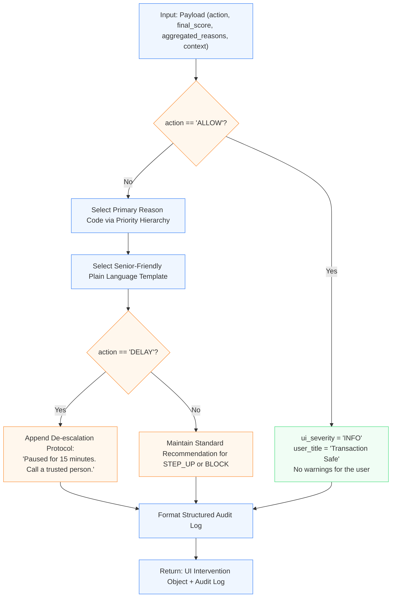

## 1. Contract I/O

*   **Input:**
    ```python
    payload = {
    "transaction_id": str,           # Unique transaction ID (e.g., "tx_987213812")
    "final_score": float,            # Aggregated risk score from Correlation Engine (0.0 to 1.0)
    "action": str,                   # "ALLOW" | "STEP_UP" | "DELAY" | "BLOCK"
    "aggregated_reasons": list[str], # List of reason codes from all upstream modules
    "context": {                     # Dynamic transaction metadata for message formatting
        "domain": str | None,        # Target website/domain (e.g., "mbank.pl.weryfikacja.top")
        "amount": float | None,      # Transaction amount
        "history_avg_amount": float | None, 
        "closest_brand": str | None  
    }
}
    ```

*   **Output:**
    ```python
    result = {
    "transaction_id": str,
    "user_intervention": {
        "ui_severity": str,          # "INFO" | "WARNING" | "CRITICAL"
        "user_title": str,           # Concise, understandable header without IT jargon
        "user_message": str,         # Empathetic, dynamic explanation of the threat in plain language
        "recommended_action": str    # Direct, actionable safety instruction for seniors
    },
    "audit_trail": str               # Concise audit record for security analysts
}
    ```

---

## 2. Module Execution Flow



---

## 3. Algorithm & Data Logistics


1.  **Hierarchy of Primary Reason Selection:**
    *   To prevent cognitive overload for users (especially seniors), the module resolves multiple technical reason codes into a single primary reason according to a strict priority hierarchy:
        1. HOMOGLYPH_DETECTED / TYPOSQUATTING_LEVENSHTEIN (Identity Deception / Fake site).
        2. ACCOUNT_DRAIN_ZERO_BALANCE (Immediate attempt to drain savings).
        3. MULE_DEST_ANOMALY (Mule network destination routing funds to criminals).
        4. CROSS_LAYER_SYNERGY_PENALTY (Unusual transaction behavior combined with unverified web origin).
        5. DGA_HIGH_ENTROPY / ONNX_ANOMALY_HIGH (Statistical and AI model anomalies).
        6. Fallbacks (UNKNOWN_DOMAIN, FALLBACK_TRIGGERED, UNKNOWN_REASON)

2.  **Plain Language Transformation:**
    *   Jargon Elimination: It is strictly forbidden to use technical words such as "entropy", "homoglyph", "ONNX model", or "Punycode".
    *   Example: Instead of "UTS-39 homoglyph attack detected", the message must read: "The website is impersonating your bank using substituted letters.".*

3.  **Dynamic Context & De-Escalation Formatting Logic:**
    *   Currency & Domain Formatting: Amounts are formatted dynamically into standard local currency representation. If the domain is missing, a generic fallback like "this page" is injected.
    *   De-Escalation Protocol: Scammers frequently attempt to instill urgency and force immediate action. When action == "DELAY", the module appends a calm anti-panic mandate to the messages::
        *   Action Prompt: "Your money is safe in the bank. You have 15 minutes to calmly think about it and contact someone you trust."

---

## 4. Complete Reason Code Mapping Dictionary

| Technical Code | UI Severity | Header (`user_title`) | Senior-Friendly Message (`user_message`) | Recommended Action (`recommended_action`) |
| --- | --- | --- | --- | --- |
| **`BLACKLISTED_PHISH`** | CRITICAL | Blacklisted Fake Site | "This website has been reported as a password-stealing scam." | "Close the page. Do not enter any data or SMS codes." |
| **`HOMOGLYPH_DETECTED`** | CRITICAL | Fake Website | "The website address looks like your bank's name, but it contains hidden characters from another alphabet." | "Close this page. Access the bank by typing the address manually or through the official app."|
| **`TYPOSQUATTING_LEVENSHTEIN`** | WARNING | Suspicious Website Address | "There is a slight typo in the bank's website address. This could be a fake site created by scammers." | "Do not enter passwords or SMS codes. Carefully check the address in your browser." |
| **`ACCOUNT_DRAIN_ZERO_BALANCE`** | CRITICAL | Account Drain | "This transfer withdraws almost all your money at once. This is a typical method used by scammers." | "If someone tells you to transfer savings to a 'safe account' – hang up, it is a scam attempt." |
| **`MULE_DEST_ANOMALY`** | CRITICAL | Suspicious Recipient Account | "The recipient's account shows characteristics of a temporary account used by scammers." | "Interrupt the transaction and consult the bank's hotline." |
| **`CROSS_LAYER_SYNERGY_PENALTY`** | WARNING | Unusual Operation | "Combining an unknown website address with this transfer amount falls outside your daily habits." | "Hold off on the transfer. Consult this transfer with a family member or call the bank's hotline." |
| **`UNUSUAL_AMOUNT`** | WARNING | Unusually High Amount | "The transfer amount is significantly higher than your usual payments." | "Carefully check the entered amount and recipient details before confirming." |
| **`DGA_HIGH_ENTROPY`** | WARNING | Suspicious Website Address | "The website address consists of random characters and may be unsafe." | "Do not continue the transaction on this page." |
| **`ONNX_ANOMALY_HIGH`** | WARNING | Unusual Transfer Pattern | "The system detected an unusual execution of this transaction, resembling scam patterns." | "Carefully verify if you are confirming the correct transfer." |
| **`HIGH_RISK_TX_TYPE`** | INFO | High-Risk Operation | "You are making an external transfer or withdrawal that requires additional confirmation." | "Ensure the recipient details are correct." |
| **`FALLBACK_TRIGGERED`** | WARNING | Additional System Verification | "The security system is performing an extra check on your transaction." | "Follow the instructions on the screen." |
| **`UNKNOWN_REASON`** (Default) | WARNING | Unusual Operation Detected | "The transaction requires additional verification for safety reasons." | "When in doubt, contact the bank." |

