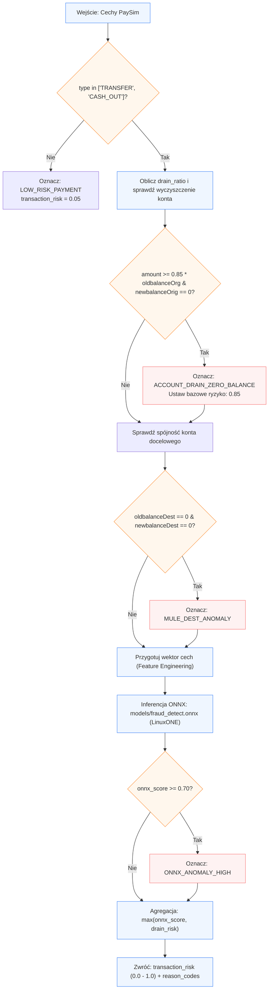

## 1. Kontrakt I/O

*   **Wejście:**
    ```python
    payload = {
        "type": str,               # Typ transakcji: "TRANSFER", "CASH_OUT", "PAYMENT", "DEBIT"
        "amount": float,           # Kwota bieżącej operacji
        "oldbalanceOrg": float,    # Saldo początkowe nadawcy
        "newbalanceOrig": float,   # Saldo końcowe nadawcy
        "oldbalanceDest": float,   # Saldo początkowe odbiorcy
        "newbalanceDest": float    # Saldo końcowe odbiorcy
    }
    ```

*   **Wyjście:**
    ```python
    result = {
        "transaction_risk": float, # Znormalizowany wynik ryzyka: 0.0 (bezpieczna) do 1.0 (anomalia)
        "reason_codes": list[str], # np. ["ACCOUNT_DRAIN_ZERO_BALANCE", "ONNX_ANOMALY_HIGH"]
        "details": {
            "onnx_score": float,
            "drain_ratio": float,
            "is_account_drain": bool,
            "is_high_risk_type": bool,
            "dest_balance_anomaly": bool
        }
    }
    ```

---

## 2. Przepływ logiczny (Mermaid)



---

## 3. Algorytm i logistyka danych

1.  **Filtrowanie typu transakcji (PaySim domain knowledge):**
    *   W zbiorze PaySim 100% potwierdzonych oszustw występuje wyłącznie w operacjach `TRANSFER` oraz `CASH_OUT`.
    *   Jeśli operacja to `PAYMENT` lub `DEBIT`: pomijana jest ciężka analiza, zwracane jest ryzyko bazowe `0.05`.

2.  **Detekcja drenażu konta (Zero-Balance Drain):**
    *   Wyliczenie wskaźnika drenażu:
        $$R_{\text{drain}} = \frac{\text{amount}}{\text{oldbalanceOrg} + \epsilon}$$
    *   Warunek krytyczny: jeśli $R_{\text{drain}} \ge 0.85$ oraz $\text{newbalanceOrig} \le 0.05 \times \text{oldbalanceOrg}$, transakcja wyczerpuje niemal całe środki ofiary $\rightarrow$ przypisanie flagi ACCOUNT_DRAIN_ZERO_BALANCE i podniesienie progu ryzyka do minimum 0.85.

3.  **Weryfikacja anomalii odbiorcy (Mule Account / Rachunek słupa):**
    *   Brak przyrostu salda docelowego przy transferze dużej kwoty (`oldbalanceDest == 0` i `newbalanceDest == 0`) wskazuje na rachunek techniczny przestępcy lub błąd księgowania typowy dla zsyntetyzowanych wektorów fraudu \\(\rightarrow\\) flaga `MULE_DEST_ANOMALY`.

4.  **Ekstrakcja wektora i inferencja modelu ONNX (`s390x`):**
    *   Konstrukcja wektora wejściowego z normalizacją:
	$$X = [\text{type\_enc}, \; \log_{1p}(\text{amount}), \; \text{oldbalanceOrg}, \; \text{newbalanceOrig}, \; \text{oldbalanceDest}, \; \text{newbalanceDest}, \; R_{\text{drain}}]$$
    *   Wywołanie sesji `onnxruntime.InferenceSession("models/fraud_detect.onnx")` uruchamianej natywnie na LinuxONE.
    *   Odczyt prawdopodobieństwa wyjściowego $P(\text{fraud}) \in [0.0, 1.0]$ jako onnx_score.

5.  **Kalkulacja `transaction_risk`:**
    *   Deterministyczna agregacja zabezpieczająca:
$$\text{transaction\_risk} = \min\left(1.0, \; \max(\text{onnx\_score}, \; \mathbb{I}_{\text{drain}} \times 0.85)\right)$$

---

## 4. Kody przyczyn (Reason Codes dla modułu Explainability)

*   `ACCOUNT_DRAIN_ZERO_BALANCE`: Próba nagłego wyczyszczenia niemal całości salda konta do zera.
*   `HIGH_RISK_TX_TYPE`: Transakcja typu TRANSFER/CASH_OUT podwyższonego ryzyka.
*   `MULE_DEST_ANOMALY`: Odbiorca wykazuje anomalie salda charakterystyczne dla rachunków tranzytowych ("słupów").
*   `ONNX_ANOMALY_HIGH`: Model sekwencyjny/tabelaryczny ONNX wykrył wzorzec oszustwa w dynamice transakcji.
