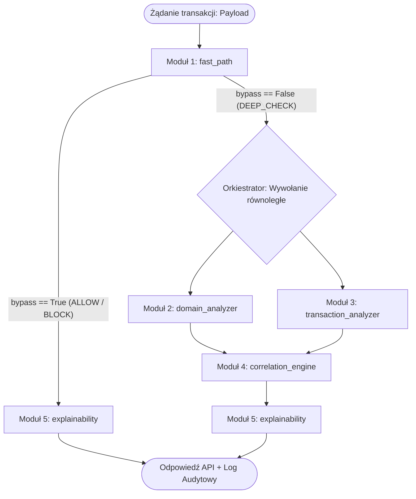

# Pipeline Integration Contract: Hybrid Fraud & Phishing Detection System
Platform Target: LinuxONE / s390x / Python 3.11+
Latency Budget: < 25 ms per transaction

---

## 1. Global Data Flow Architecture

System przetwarza zapytanie w 3 fazach:
1. Triage wstępny (Fast-Path) – natychmiastowe odrzucenie lub dopuszczenie.
2. Równoległa analiza głęboka (Domain & Transaction Analyzers).
3. Synteza ryzyka i interwencja (Correlation Engine & Explainability).



---

## 2. Global Unified Schemas (Kontrakty API)

### Wejście do potoku (`PipelineRequest`)
```json
{
  "transaction_id": "tx_987213812",
  "domain": "mbank.pl.weryfikacja-konta.top",
  "transaction": {
    "type": "TRANSFER",
    "amount": 14500.00,
    "oldbalanceOrg": 15000.00,
    "newbalanceOrig": 500.00,
    "oldbalanceDest": 0.00,
    "newbalanceDest": 0.00
  },
  "user_context": {
    "history_avg_amount": 350.00
  }
}
```

### Wyjście z potoku (`PipelineResponse`)
```json
{
  "transaction_id": "tx_987213812",
  "action": "DELAY",
  "final_score": 0.72,
  "override_triggered": false,
  "aggregated_reasons": [
    "TYPOSQUATTING_LEVENSHTEIN",
    "ACCOUNT_DRAIN_ZERO_BALANCE",
    "CROSS_LAYER_SYNERGY_PENALTY"
  ],
  "user_intervention": {
    "severity": "WARNING",
    "title": "Podejrzana operacja wstrzymana",
    "message": "Adres strony różni się od strony banku, a przelew opróżnia konto. Wstrzymano na 15 minut.",
    "action_prompt": "Zadzwoń do banku lub bliskiej osoby. Pieniądze są bezpieczne."
  },
  "audit_trail": "[AUDIT] ID=tx_987213812 SCORE=0.72 ACTION=DELAY REASONS=TYPOSQUATTING,DRAIN"
}
```

---

## 3. Matryca Odpowiedzialności Modułów

| Moduł | Rola | Sygnał wyjściowy | Waga w silniku |
| :--- | :--- | :--- | :--- |
| **`fast_path`** | Filtrowanie biała/czarna lista | `verdict`, `bypass_pipeline` | Decyzja natychmiastowa |
| **`domain_analyzer`** | Homoglify, Levenshtein, DGA | `domain_risk` (0.0 – 1.0) | 45% (lub Critical Override) |
| **`transaction_analyzer`** | Behawiorystyka PaySim + ONNX | `tx_risk` (0.0 – 1.0) | 55% (lub Critical Override) |
| **`correlation_engine`** | Fuzja wagowa, reguły synergii | `final_score`, `action` | Decyzja biznesowa |
| **`explainability`** | Przekład na prosty język i audyt | `user_intervention`, `audit` | Warstwa prezentacji |

---

## 4. Zasady Orkiestracji (Wytyczne dla Kodu)

1. **Short-circuiting:** Jeśli `fast_path` zwróci `bypass_pipeline == True`, moduły 2, 3 i 4 nie są uruchamiane. Przekaż wynik wprost do `explainability`.
2. **Wykonywanie równoległe:** Wywołania `domain_analyzer` i `transaction_analyzer` muszą być asynchroniczne (`asyncio.gather` lub wątki w Pythonie), aby zminimalizować narzut czasu.
3. **Deterministyczna obsługa błędów:** Awaria jednego z modułów analitycznych (np. błąd ładowania ONNX) skutkuje przyjęciem wartości bezpiecznej (`fail-open` lub `tx_risk = 0.50` z flagą `FALLBACK_TRIGGERED`), nie wyłączając całego systemu.
